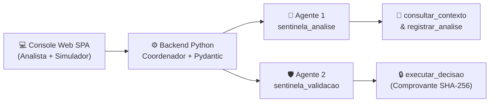

# Apresentação de Slides — Sentinela (3 Minutos | 5 Integrantes)

---

## SLIDE 1 DE 6 — CAPA (`0:00 – 0:15` | Integrante 1)
**IBM SkillsBuild · Inteligência Artificial · Capstone Project**

# 🛡️ SENTINELA
### Análise e Validação Inteligente de Fraudes em Cartões

> *"Decisões financeiras sob incerteza não admitem suposições: exigem evidência, diálogo e auditoria."*

| Padrão de Agente | Orquestração | Segurança |
| :--- | :--- | :--- |
| **Gatekeeper de Decisão** | **IBM watsonx Orchestrate** (2 Agentes + 3 Tools) | **Contratos Pydantic + Hash SHA-256** |

- **Fala do Integrante 1 (`0:00 – 0:15`):**
  > *"Olá! Nós somos a equipe do projeto **Sentinela**. Em operações de cartão de crédito, bloquear uma compra legítima frustra o cliente; mas aprovar uma fraude gera prejuízo imediato. O Sentinela nasce para resolver transações na zona cinzenta de incerteza usando agentes reais no IBM watsonx Orchestrate."*

---

## SLIDE 2 DE 6 — O PROBLEMA E QUEM SOFRE (`0:15 – 0:30` | Integrante 1)
### O Dilema da Fraude em Tempo Real

| 👩‍⚕️ Persona Real do Projeto | ⚡ O Conflito Operacional |
| :--- | :--- |
| **Ana Beatriz Ramos**, 34 anos, farmacêutica em **Porto Alegre (RS)**. Ticket médio habitual: **R$ 350,00** em farmácias, mercados e apps locais. | ❌ **Falso Positivo:** Bloquear uma compra legítima gera atrito e perda de receita. ❌ **Falso Negativo:** Autorizar uma fraude silenciosa gera prejuízo imediato. |

### 🔍 Os 3 Sinais de Incerteza Analisados pelo Sentinela
1. **Geolocalização Incompatível:** Compra **presencial em Brasília (DF)** (`R$ 189,98` na Ticketmaster) para uma cliente que mora em **Porto Alegre (RS)** com baixa mobilidade.
2. **Valor e Frequência:** Compras fora da faixa habitual ou rajadas de tentativas em curto intervalo.
3. **Canal, Horário e Dispositivo:** Transações em categorias inéditas ou a partir de dispositivos recém-cadastrados.

- **Fala do Integrante 1 (`0:15 – 0:30`):**
  > *"Imagine a nossa persona, Ana Beatriz, farmacêutica que mora em Porto Alegre e tem baixa mobilidade. De repente, surge uma compra presencial de R$ 189,98 na Ticketmaster lá em Brasília. Regras fixas bloqueariam o cartão na hora ou deixariam uma possível clonagem passar. O problema real é decidir rápido sem agir no escuro."*

---

## SLIDE 3 DE 6 — A SOLUÇÃO E ARQUITETURA (`0:30 – 0:50` | Integrante 2)
### Padrão Gatekeeper de Decisão no IBM watsonx Orchestrate

| Camada | Papel na Arquitetura |
| :--- | :--- |
| **Agente 1 (`sentinela_analise`)** | Consulta perfil, histórico e eventos da conta via `consultar_contexto` e classifica o risco (**Baixo**, **Médio** ou **Alto**). |
| **Agente 2 (`sentinela_validacao`)** | Conduz o diálogo seguro com o cliente nos casos de risco médio e emite a decisão final via `executar_decisao`. |
| **Guardião Determinístico (Python)** | Valida contratos **Pydantic** (`extra="forbid"`) e exige comprovante criptográfico **SHA-256** no `step_history` da run. |

- **Fala do Integrante 2 (`0:30 – 0:50`):**
  > *"Para resolver isso, criamos o Sentinela no padrão **Gatekeeper de Decisão**. Quando uma transação chega ao backend Python, o primeiro agente no watsonx Orchestrate — `sentinela_analise` — aciona a ferramenta `consultar_contexto`, cruza o histórico do cliente e classifica o risco. Se o risco for médio, entra em ação o segundo agente — `sentinela_validacao` — que conversa com o cliente e só aplica o veredito final após gerar um comprovante criptográfico SHA-256 na ferramenta `executar_decisao`."*

---

## SLIDE 4 DE 6 — DEMONSTRAÇÃO AO VIVO (`0:50 – 2:20` | Integrantes 3 e 4)
### Caso Real: Ana Beatriz Ramos · Transação `TX-L9YKVZ1B`

| Etapa da Demo | O que acontece na tela do Sentinela | Resultado / Ação do Agente |
| :--- | :--- | :--- |
| **1. Seleção do Caso** | **1ª compra da lista** da Ana Beatriz: **R$ 189,98** presencial na **Ticketmaster (Brasília - DF)**. | Clique em **Analisar transação**. |
| **2. Análise Inicial (Agente 1)** | `sentinela_analise` detecta compra presencial em Brasília para cliente residente em Porto Alegre. | **Risco MÉDIO** · Estado muda para `Em validação` e gera pergunta contextualizada. |
| **3. Diálogo com Cliente (Agente 2)** | Simulador responde confirmando (ou negando) a compra no chat de validação. | `sentinela_validacao` processa a resposta e aciona `executar_decisao`. |
| **4. Evidências e Auditoria** | Tabela traduz caminhos técnicos para linguagem humana (*"Eventos Recentes › 1º item › Tipo"*). | Veredito aplicado com **Comprovante SHA-256** e exportação JSON. |

- **Fala do Integrante 3 (`0:50 – 1:35`):**
  > *"Vamos ver o sistema funcionando ao vivo. Aqui na fila da Ana Beatriz, seleciono a primeira compra da lista: 189 reais e 98 centavos na Ticketmaster, presencial em Brasília, e clico em **Analisar transação**. Em tempo real, o backend envia o caso ao agente `sentinela_analise` no watsonx Orchestrate. Veja o retorno: **Risco Médio** e recomendação de **Validar com o cliente**. O agente aponta que o valor está dentro do habitual, mas a compra foi presencial em Brasília para uma cliente de Porto Alegre com baixa mobilidade. Automaticamente, o caso muda para **Em validação** e o agente já formula a pergunta para a Ana confirmar a operação."*

- **Fala do Integrante 4 (`1:35 – 2:20`):**
  > *"Agora eu assumo o papel do cliente no nosso Simulador. Posso usar o roteiro da persona ou digitar uma resposta livre — por exemplo, negando ou confirmando a compra — e clicar em **Enviar resposta**. O segundo agente, `sentinela_validacao`, avalia a resposta na mesma thread da IBM, chama a ferramenta `executar_decisao` e encerra o caso com comprovante auditável. E reparem na seção **Evidências e Auditoria**: o sistema traduz caminhos técnicos do JSON, como `eventos_recentes.0.tipo`, para linguagem humana clara — **Eventos Recentes › 1º item › Tipo** — permitindo ao analista auditar cada fator e exportar a sessão completa."*

---

## SLIDE 5 DE 6 — LIMITES CONHECIDOS E GUARDRAILS (`2:20 – 2:40` | Integrante 4)
### Segurança Operacional: O Agente Nunca Decide no Escuro

| Guardrail / Limite | Como o Sentinela se comporta |
| :--- | :--- |
| 🛡️ **1. Contrato Estrito (`extra="forbid"`)** | Respostas fora do schema Pydantic v2 ou sem comprovante `SHA-256` acionam **encerramento preventivo** para `Pendente`. |
| ⏱️ **2. Ausência de Resposta Nunca Autoriza** | Se o cliente usar **"Simular sem resposta"** (timeout), o sistema **jamais autoriza**: encaminha obrigatoriamente para `Pendente`. |
| 💬 **3. Limite de Diálogo (`MAX_PERGUNTAS = 3`)** | Impede loops de conversação. Após 3 perguntas sem confirmação conclusiva, o caso é escalado para análise humana. |
| 💾 **4. Escopo do MVP (`ServicoCasos`)** | Estado mantido em memória (volátil ao reiniciar o servidor) e uso de dados sintéticos auditáveis (45 transações em 15 cenários). |

- **Fala do Integrante 4 (`2:20 – 2:40`):**
  > *"Um bom agente conhece seus limites. No Sentinela, o modelo de IA nunca tem carta branca: validamos cada retorno com contratos rígidos no Pydantic, limitamos o diálogo a no máximo três perguntas e garantimos por código que a ausência de resposta do cliente **nunca autoriza** uma transação — na dúvida ou em falha de rede, o sistema faz encerramento preventivo para **Pendente**, protegendo o cliente."*

---

## SLIDE 6 DE 6 — VISÃO DE FUTURO E ENCERRAMENTO (`2:40 – 3:00` | Integrante 5)
### Evolução para Produção Bancária

| Horizonte | Evolução Planejada | Impacto Esperado |
| :--- | :--- | :--- |
| **Horizonte 1 — Canais Reais & Persistência** | Banco relacional persistente (**PostgreSQL**) e integração direta com **WhatsApp Business API** e **Push no App**. | Validação instantânea no celular do cliente sem perder histórico entre sessões. |
| **Horizonte 2 — RAG Regulatório (BACEN)** | Conexão com base de conhecimento de normas do **Banco Central** e políticas internas de chargeback. | Justificativas de bloqueio enriquecidas com referência normativa oficial. |
| **Horizonte 3 — Aprendizado Contínuo** | Feedback das decisões dos analistas humanos nos casos `Pendentes` retroalimentando a calibragem de risco. | Redução contínua de falsos positivos. |

> ### *"Sentinela: inteligência artificial que investiga com dados, pergunta com clareza e só decide com prova."*

- **Fala do Integrante 5 (`2:40 – 3:00`):**
  > *"Como próximos passos para levar o Sentinela à produção bancária, planejamos três evoluções: persistência em banco de dados relacional para manter o histórico entre sessões; integração do agente de validação diretamente ao WhatsApp e notificações push do aplicativo do banco; e uso de RAG com normas regulatórias do Banco Central. Com o Sentinela, mostramos na prática como unir o raciocínio do IBM watsonx Orchestrate à segurança determinística de software. Muito obrigado!"*
